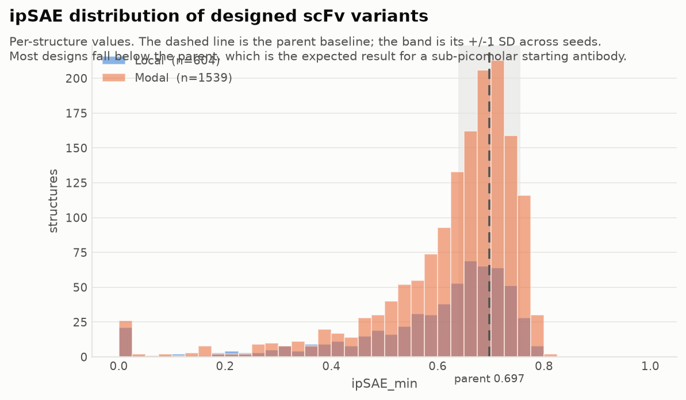
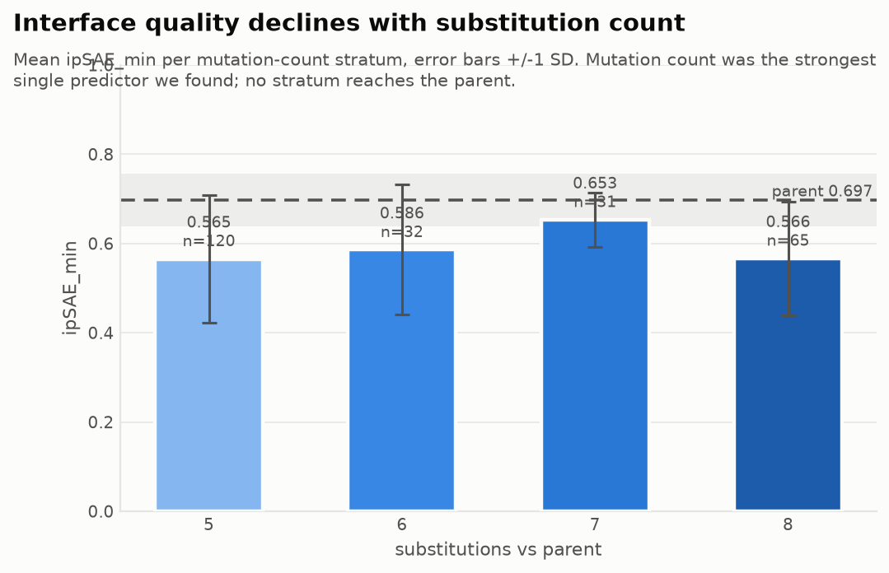
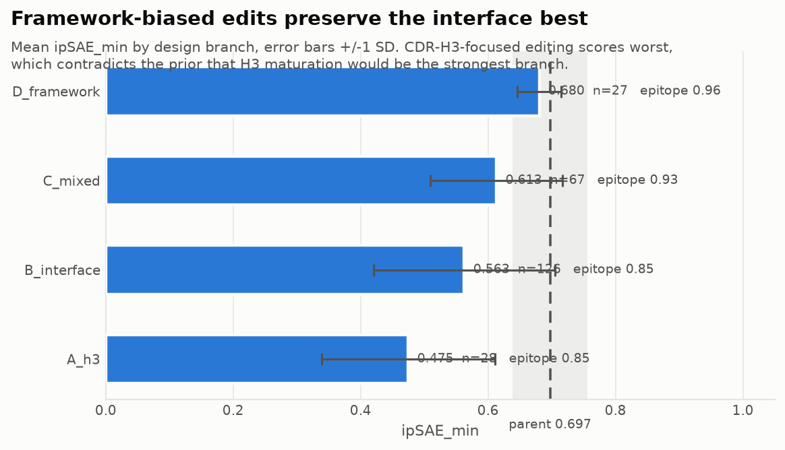
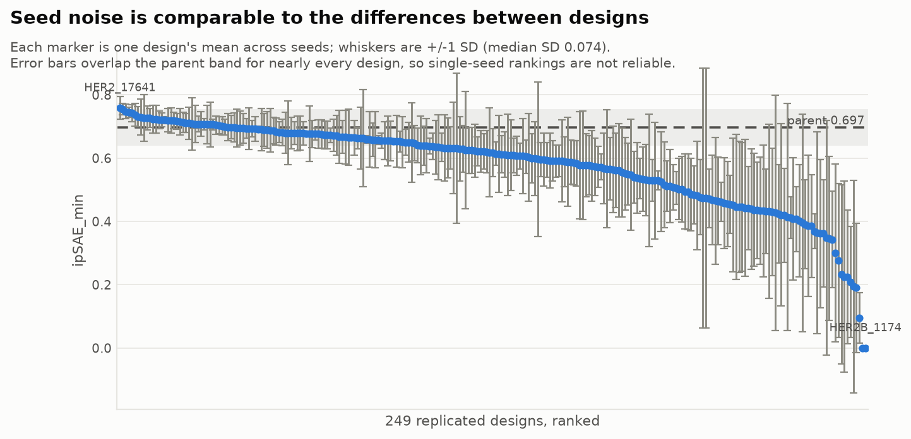
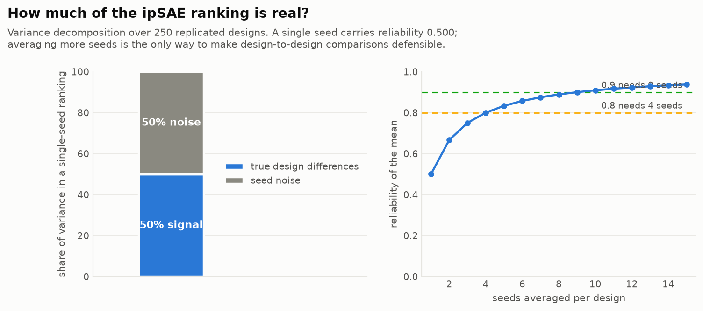
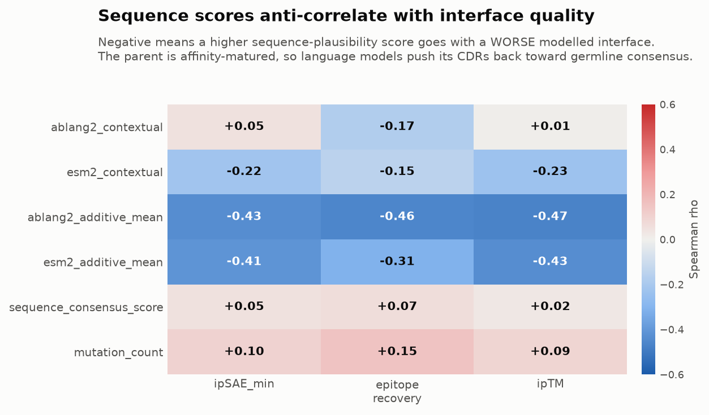
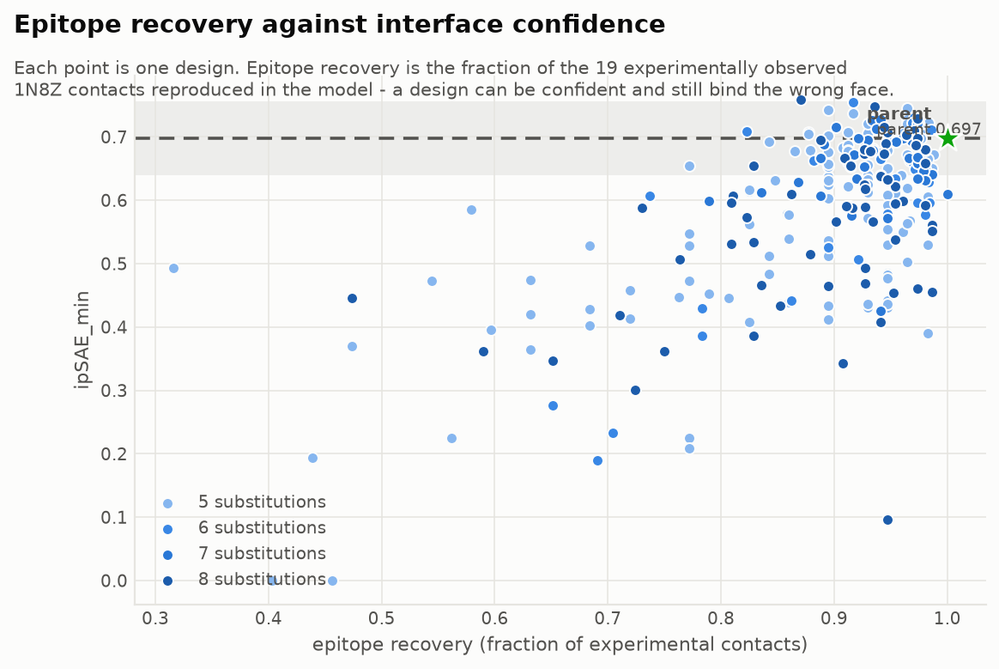
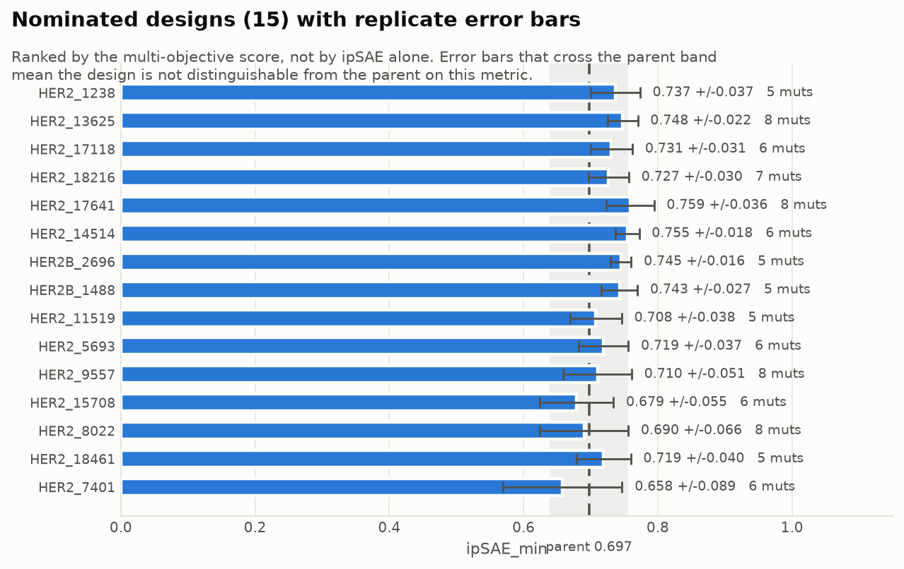
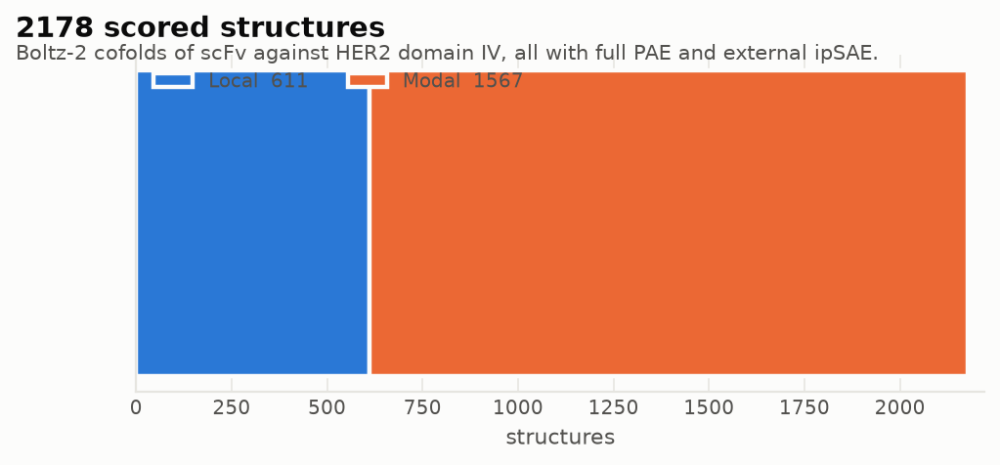

# Final designs report - HER2 scFv optimisation

Generated 2026-10-31T15:33:22+00:00.

> **Claim boundary.** Every value here is a computational ranking signal for experimental triage. ipSAE is not a binding affinity, ipTM is not ipSAE, and a higher score is not a demonstrated improvement. No K_D is predicted.

## Headline

| Quantity | Value |
| --- | ---: |
| Designs with a genuine external ipSAE | **248** |
| Structures behind them | 2178 |
| Local / Modal structures | 611 / 1567 |
| Ranked submission set | 50 |
| Lab nominations | 15 |
| Parent replicates | 35 |
| Compliance audit | **PASS** (0 failed) |

Parent baseline: **0.6973** +/- 0.0583 over 35 seeds.

### How each design compares with the parent

| Verdict | Designs |
| --- | ---: |
| ABOVE_PARENT | 0 |
| BELOW_PARENT | 109 |
| WITHIN_SEED_NOISE | 139 |
| SINGLE_SEED_UNRELIABLE | 0 |
| NO_PARENT_BASELINE | 0 |

`SINGLE_SEED_UNRELIABLE` means the design has one replicate, which at the measured reliability cannot support a directional claim either way.

## Top 50 ranked designs

Ranked by the multi-objective score (sequence consensus, ipSAE, epitope recovery, structural confidence, developability), **not** by ipSAE alone.

| # | design | branch | muts | ipSAE | sd | n | delta vs parent | epitope | ipTM | interface | verdict |
| ---: | --- | --- | ---: | ---: | ---: | ---: | ---: | ---: | ---: | --- | --- |
| 1 | `HER2_11519` | C_mixed | 5 | 0.7076 | 0.038 | 33 | 0.0103 | 0.976 | 0.898 | OK | indistinguishable |
| 2 | `HER2_1238` | B_interface | 5 | 0.7368 | 0.037 | 33 | 0.0395 | 0.917 | 0.907 | OK | above |
| 3 | `HER2_5693` | D_framework | 6 | 0.7193 | 0.037 | 32 | 0.0220 | 0.975 | 0.898 | OK | indistinguishable |
| 4 | `HER2_15056` | B_interface | 7 | 0.7080 | 0.059 | 15 | 0.0107 | 0.972 | 0.902 | OK | indistinguishable |
| 5 | `HER2_17465` | D_framework | 8 | 0.7293 | 0.056 | 16 | 0.0320 | 0.974 | 0.907 | OK | indistinguishable |
| 6 | `HER2_9557` | A_h3 | 8 | 0.7101 | 0.051 | 32 | 0.0128 | 0.970 | 0.905 | OK | indistinguishable |
| 7 | `HER2_13625` | C_mixed | 8 | 0.7478 | 0.022 | 32 | 0.0505 | 0.936 | 0.913 | OK | above |
| 8 | `HER2_17118` | C_mixed | 6 | 0.7308 | 0.031 | 16 | 0.0335 | 0.970 | 0.904 | OK | above |
| 9 | `HER2_15708` | D_framework | 6 | 0.6789 | 0.055 | 16 | -0.0184 | 0.980 | 0.894 | OK | indistinguishable |
| 10 | `HER2_14954` | D_framework | 6 | 0.7227 | 0.044 | 31 | 0.0254 | 0.969 | 0.903 | OK | above |
| 11 | `HER2_18216` | D_framework | 7 | 0.7267 | 0.030 | 15 | 0.0294 | 0.933 | 0.905 | OK | above |
| 12 | `HER2_19503` | D_framework | 6 | 0.7110 | 0.031 | 15 | 0.0137 | 0.986 | 0.897 | OK | indistinguishable |
| 13 | `HER2_23723` | C_mixed | 5 | 0.7226 | 0.044 | 16 | 0.0253 | 0.984 | 0.907 | OK | indistinguishable |
| 14 | `HER2_21202` | C_mixed | 6 | 0.7207 | 0.022 | 16 | 0.0234 | 0.974 | 0.903 | OK | above |
| 15 | `HER2_8022` | B_interface | 8 | 0.6901 | 0.066 | 31 | -0.0072 | 0.946 | 0.894 | OK | indistinguishable |
| 16 | `HER2_17254` | D_framework | 7 | 0.7269 | 0.038 | 8 | 0.0296 | 0.941 | 0.905 | OK | indistinguishable |
| 17 | `HER2_0077` | B_interface | 5 | 0.6400 | 0.093 | 18 | -0.0573 | 0.959 | 0.876 | OK | below |
| 18 | `HER2_8386` | C_mixed | 5 | 0.6939 | 0.031 | 16 | -0.0034 | 0.954 | 0.891 | OK | indistinguishable |
| 19 | `HER2_18461` | C_mixed | 5 | 0.7192 | 0.040 | 15 | 0.0219 | 0.933 | 0.904 | OK | indistinguishable |
| 20 | `HER2_13086` | C_mixed | 7 | 0.6663 | 0.085 | 17 | -0.0310 | 0.966 | 0.888 | OK | indistinguishable |
| 21 | `HER2_21848` | B_interface | 5 | 0.6928 | 0.039 | 8 | -0.0045 | 0.954 | 0.892 | OK | indistinguishable |
| 22 | `HER2_7401` | B_interface | 6 | 0.6580 | 0.089 | 30 | -0.0393 | 0.970 | 0.877 | OK | below |
| 23 | `HER2_15853` | D_framework | 7 | 0.6581 | 0.054 | 8 | -0.0392 | 0.974 | 0.885 | OK | indistinguishable |
| 24 | `HER2_13727` | C_mixed | 8 | 0.6798 | 0.101 | 8 | -0.0175 | 0.980 | 0.888 | OK | indistinguishable |
| 25 | `HER2_8533` | D_framework | 7 | 0.6408 | 0.055 | 16 | -0.0565 | 0.987 | 0.884 | OK | below |
| 26 | `HER2_15259` | D_framework | 8 | 0.7066 | 0.060 | 8 | 0.0093 | 0.947 | 0.899 | OK | indistinguishable |
| 27 | `HER2_24532` | D_framework | 7 | 0.6932 | 0.066 | 10 | -0.0041 | 0.968 | 0.895 | OK | indistinguishable |
| 28 | `HER2_10808` | B_interface | 8 | 0.6728 | 0.043 | 17 | -0.0245 | 0.944 | 0.888 | OK | indistinguishable |
| 29 | `HER2_15323` | B_interface | 5 | 0.6820 | 0.033 | 8 | -0.0153 | 0.934 | 0.894 | OK | indistinguishable |
| 30 | `HER2_12026` | C_mixed | 7 | 0.6892 | 0.052 | 8 | -0.0081 | 0.928 | 0.893 | OK | indistinguishable |
| 31 | `HER2_15988` | B_interface | 8 | 0.7160 | 0.026 | 15 | 0.0187 | 0.944 | 0.900 | OK | indistinguishable |
| 32 | `HER2_17641` | C_mixed | 8 | 0.7587 | 0.036 | 15 | 0.0614 | 0.870 | 0.914 | OK | above |
| 33 | `HER2B_0719` | B_interface | 5 | 0.6810 | 0.043 | 9 | -0.0163 | 0.977 | 0.895 | OK | indistinguishable |
| 34 | `HER2_0070` | B_interface | 5 | 0.6638 | 0.034 | 18 | -0.0335 | 0.892 | 0.877 | OK | below |
| 35 | `HER2B_1130` | B_interface | 5 | 0.6980 | 0.042 | 9 | 0.0007 | 0.977 | 0.902 | OK | indistinguishable |
| 36 | `HER2_10341` | C_mixed | 8 | 0.6587 | 0.088 | 8 | -0.0386 | 0.980 | 0.877 | OK | indistinguishable |
| 37 | `HER2_14514` | C_mixed | 6 | 0.7546 | 0.018 | 17 | 0.0573 | 0.916 | 0.913 | OK | above |
| 38 | `HER2_24248` | D_framework | 8 | 0.6982 | 0.024 | 8 | 0.0009 | 0.974 | 0.896 | OK | indistinguishable |
| 39 | `HER2_26656` | C_mixed | 5 | 0.6627 | 0.098 | 16 | -0.0346 | 0.967 | 0.885 | OK | indistinguishable |
| 40 | `HER2_28172` | D_framework | 7 | 0.7131 | 0.032 | 15 | 0.0158 | 0.937 | 0.904 | OK | indistinguishable |
| 41 | `HER2_22721` | C_mixed | 5 | 0.7064 | 0.071 | 8 | 0.0091 | 0.961 | 0.896 | OK | indistinguishable |
| 42 | `HER2_22350` | C_mixed | 8 | 0.7035 | 0.027 | 13 | 0.0062 | 0.964 | 0.895 | OK | indistinguishable |
| 43 | `HER2B_0949` | B_interface | 5 | 0.7190 | 0.025 | 9 | 0.0217 | 0.942 | 0.899 | OK | indistinguishable |
| 44 | `HER2_13103` | B_interface | 6 | 0.7081 | 0.083 | 8 | 0.0108 | 0.822 | 0.901 | OK | indistinguishable |
| 45 | `HER2_6796` | C_mixed | 6 | 0.6339 | 0.045 | 8 | -0.0634 | 0.954 | 0.869 | OK | below |
| 46 | `HER2_7827` | C_mixed | 8 | 0.6735 | 0.044 | 15 | -0.0238 | 0.926 | 0.885 | OK | indistinguishable |
| 47 | `HER2_20989` | D_framework | 7 | 0.6673 | 0.083 | 10 | -0.0300 | 0.974 | 0.885 | OK | indistinguishable |
| 48 | `HER2_23267` | D_framework | 7 | 0.6469 | 0.056 | 10 | -0.0504 | 0.979 | 0.884 | OK | below |
| 49 | `HER2_17485` | B_interface | 8 | 0.6801 | 0.066 | 15 | -0.0172 | 0.926 | 0.886 | OK | indistinguishable |
| 50 | `HER2_1401` | B_interface | 8 | 0.6212 | 0.065 | 16 | -0.0761 | 0.954 | 0.855 | OK | below |

## Lab nominations

| # | design | branch | substitutions | ipSAE | epitope | rank shift |
| ---: | --- | --- | --- | ---: | ---: | ---: |
| 1 | `HER2_1238` | B_interface | `T32Y;N55G;A79L;A186T;T232A` | 0.7368 | 0.917 | 1 |
| 2 | `HER2_13625` | C_mixed | `Q13R;N28T;Y52T;P53S;T69S;I70V;D73E;A169N` | 0.7478 | 0.936 | 3 |
| 3 | `HER2_17118` | C_mixed | `L86P;S97A;A169N;Q173H;A186E;K238N` | 0.7308 | 0.970 | 11 |
| 4 | `HER2_18216` | D_framework | `D31T;A49S;Q82E;L86V;T207S;Q235G;K238R` | 0.7267 | 0.933 | 3 |
| 5 | `HER2_17641` | C_mixed | `A24V;Y52S;D62E;A79L;E89D;S185V;S195L;S212N` | 0.7587 | 0.870 | 19 |
| 6 | `HER2_14514` | C_mixed | `T32Y;I51V;N55E;Q82E;S119P;Q173H` | 0.7546 | 0.916 | 39 |
| 7 | `HER2B_2696` | B_interface | `T32Y;A61G;A72R;T166N;T228S` | 0.7448 | 0.965 | 92 |
| 8 | `HER2B_1488` | B_interface | `T32F;N55G;A167Y;V168L;R201G` | 0.7428 | 0.895 | 66 |
| 9 | `HER2_11519` | C_mixed | `I29F;L181F;R201G;I210V;S212G` | 0.7076 | 0.976 | 1 |
| 10 | `HER2_5693` | D_framework | `A79V;S97A;T157A;A169N;V193A;T209I` | 0.7193 | 0.975 | 2 |
| 11 | `HER2_9557` | A_h3 | `T32Y;W47Y;E89D;G101T;Y105N;Y109F;S185A;S191I` | 0.7101 | 0.970 | 6 |
| 12 | `HER2_15708` | D_framework | `S7T;A72R;M83L;E89D;L115T;Y171F` | 0.6789 | 0.980 | 12 |
| 13 | `HER2_8022` | B_interface | `T54G;R59Y;I70T;T155S;A160T;T166N;Y184H;R201G` | 0.6901 | 0.946 | 11 |
| 14 | `HER2_18461` | C_mixed | `I51V;S75A;E89D;I137V;Y184F` | 0.7192 | 0.933 | 15 |
| 15 | `HER2_7401` | B_interface | `L20V;D62E;V64L;F104N;D163G;V164I` | 0.6580 | 0.970 | 35 |

`rank shift` is how far a design moves under three alternative weightings; a large value means its position depends on one metric.

## Exported binder packages

12 designs exported to `outputs/binders/<id>/` with `sequence.fasta`, `design.json`, `complex.cif`, `pae.npz`, `interface_contacts.csv` and `mutations.csv`. Rotating 3D animations are in `outputs/gifs/`.

| design | muts | modelled contacts | epitope recovery | folder |
| --- | ---: | ---: | ---: | --- |
| `HER2_11519` | 5 | 30 | 0.976 | `binders/HER2_11519` |
| `HER2_1238` | 5 | 30 | 0.917 | `binders/HER2_1238` |
| `HER2_5693` | 6 | 31 | 0.975 | `binders/HER2_5693` |
| `HER2_15056` | 7 | 31 | 0.972 | `binders/HER2_15056` |
| `HER2_17465` | 8 | 29 | 0.974 | `binders/HER2_17465` |
| `HER2_9557` | 8 | 31 | 0.970 | `binders/HER2_9557` |
| `HER2_13625` | 8 | 31 | 0.936 | `binders/HER2_13625` |
| `HER2_17118` | 6 | 30 | 0.970 | `binders/HER2_17118` |
| `HER2_15708` | 6 | 27 | 0.980 | `binders/HER2_15708` |
| `HER2_14954` | 6 | 31 | 0.969 | `binders/HER2_14954` |
| `HER2_18216` | 7 | 29 | 0.933 | `binders/HER2_18216` |
| `HER2_19503` | 6 | 31 | 0.986 | `binders/HER2_19503` |

## Figures

**ipSAE distribution of designed variants**

**Interface quality vs substitution count**

**Interface quality by design branch**

**Seed noise against between-design differences**

**How much of the ipSAE ranking is real**

**Sequence scores vs structural outcomes**

**Epitope recovery against interface confidence**

**Nominated designs with replicate error bars**

**Structures scored, by compute source**

## Limitations

- ipSAE, ipTM, pDockQ and LIS are model-confidence measures, not affinities.
- The parent is ~0.82 pM; assay floor effects make improvement hard to show even experimentally.
- The domain IV crop removes receptor context and glycans; it is required by the organizer and applied identically to parent and candidates.
- MSA reuse keeps the parent's homolog block, which slightly favours designs closer to the parent. A fresh-MSA control was attempted but did not complete.
- AbLang2, ESM2 and ESM-C never see HER2; they reject implausible sequences, they do not identify better binders.
- Selection weights are a reasoned hypothesis, quantified by the sensitivity analysis.

