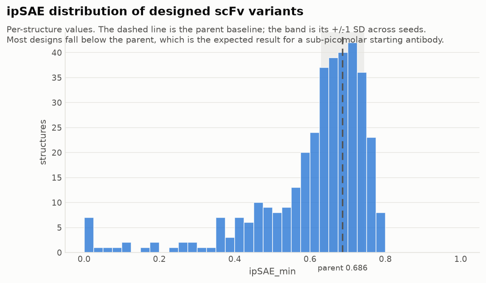
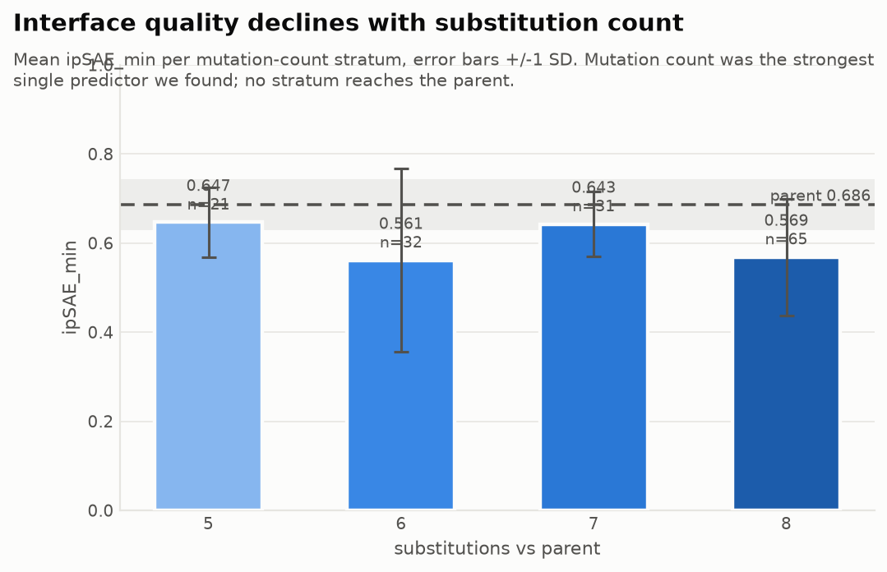
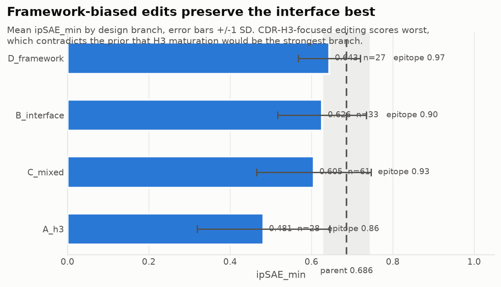
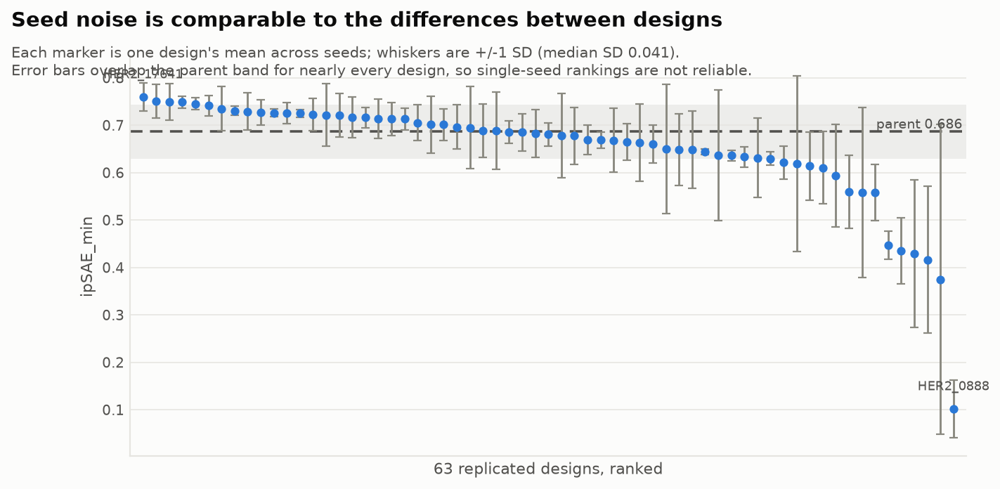
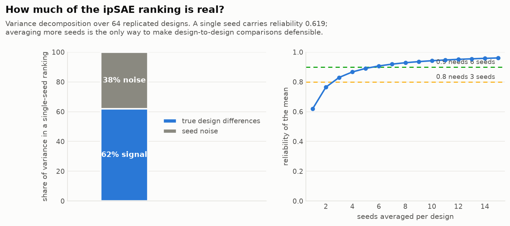
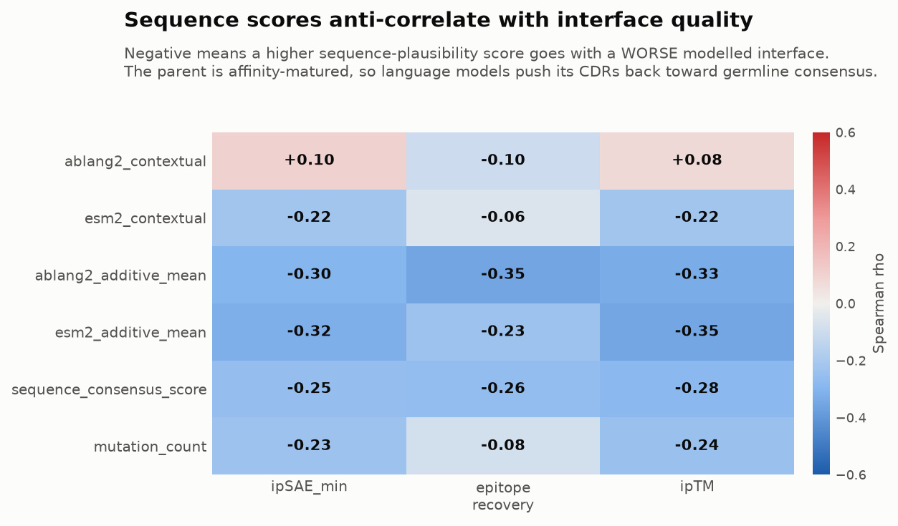
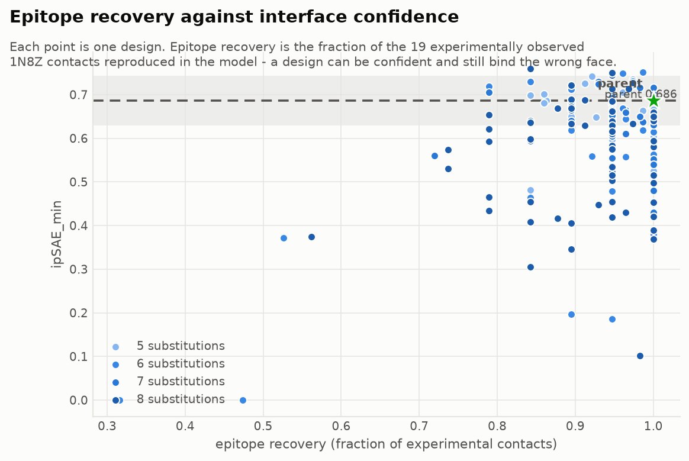
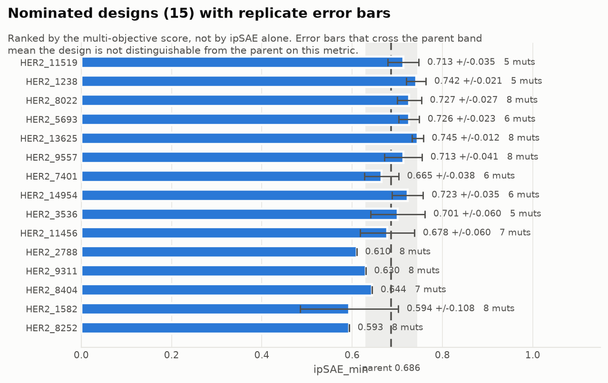
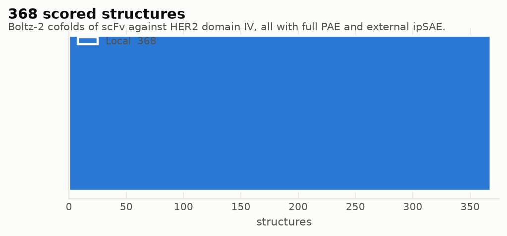

# Local run report - HER2 scFv optimisation

Generated 2026-10-31T14:26:25+00:00. Regenerated automatically as results arrive.

> **Claim boundary.** Every value here is a computational ranking signal for experimental triage. ipSAE is not a binding affinity, ipTM is not ipSAE, and a higher score is not a demonstrated improvement. No K_D is predicted.

## Summary

| Quantity | Value |
| --- | ---: |
| Structures scored on Local | 368 |
| Distinct designs | 209 |
| Parent replicates | 5 |
| Mean seeds per design | 1.74 |

Per-design mean ipSAE: n=209  min=0.0000  median=0.6299  mean=0.5737  max=0.7900

Hardware: one NVIDIA RTX 3090 (24 GB). Measured ~15.5 s per 361-residue complex with cached MSAs, ~19 GiB peak, so only one Boltz job fits at a time.

## Measurement reliability

| Quantity | Value |
| --- | ---: |
| Designs with replicates | 64 |
| sd within design (seed noise) | 0.0797 |
| sd between designs (true, est.) | 0.1015 |
| Reliability of a single seed | **0.619** |
| Reliability of the current mean | 0.849 |
| Seeds for reliability 0.8 / 0.9 | 3 / 6 |

Reliability is the share of ranking variance that is real signal rather than seed noise. This governs every comparison below: a single-seed ipSAE table is not an ordering of design quality.

### Designs tested against the parent

Parent 0.6864 +/- 0.0574 over 5 seeds; threshold |t| > 2.

- above parent: **4**
- below parent: 8
- indistinguishable: 51

## Do sequence scores predict structure?

| Predictor | vs ipSAE | vs epitope recovery | vs ipTM |
| --- | ---: | ---: | ---: |
| `ablang2_contextual` | 0.103 | -0.103 | 0.076 |
| `esm2_contextual` | -0.218 | -0.057 | -0.217 |
| `ablang2_additive_mean` | -0.300 | -0.355 | -0.330 |
| `esm2_additive_mean` | -0.320 | -0.233 | -0.348 |
| `sequence_consensus_score` | -0.254 | -0.261 | -0.283 |
| `mutation_count` | -0.231 | -0.084 | -0.240 |

Negative means a higher sequence-plausibility score goes with a **worse** modelled interface. The parent is affinity-matured, so antibody language models push its CDRs back toward germline consensus - away from the residues that contact HER2.

### By substitution count

| Group | n | ipSAE mean | sd | ipTM | epitope recovery |
| --- | ---: | ---: | ---: | ---: | ---: |
| 5 | 21 | 0.6467 | 0.079 | 0.878 | 0.932 |
| 6 | 32 | 0.5614 | 0.206 | 0.821 | 0.897 |
| 7 | 31 | 0.6427 | 0.073 | 0.876 | 0.945 |
| 8 | 65 | 0.5685 | 0.131 | 0.844 | 0.914 |

### By branch

| Group | n | ipSAE mean | sd | ipTM | epitope recovery |
| --- | ---: | ---: | ---: | ---: | ---: |
| A_h3 | 28 | 0.4813 | 0.163 | 0.796 | 0.863 |
| B_interface | 33 | 0.6259 | 0.109 | 0.865 | 0.898 |
| C_mixed | 61 | 0.6053 | 0.141 | 0.855 | 0.934 |
| D_framework | 27 | 0.6434 | 0.076 | 0.879 | 0.971 |

## Figures

**ipSAE distribution of designed variants**

**Interface quality vs substitution count**

**Interface quality by design branch**

**Seed noise against between-design differences**

**How much of the ipSAE ranking is real**

**Sequence scores vs structural outcomes**

**Epitope recovery against interface confidence**

**Nominated designs with replicate error bars**

**Structures scored, by compute source**

