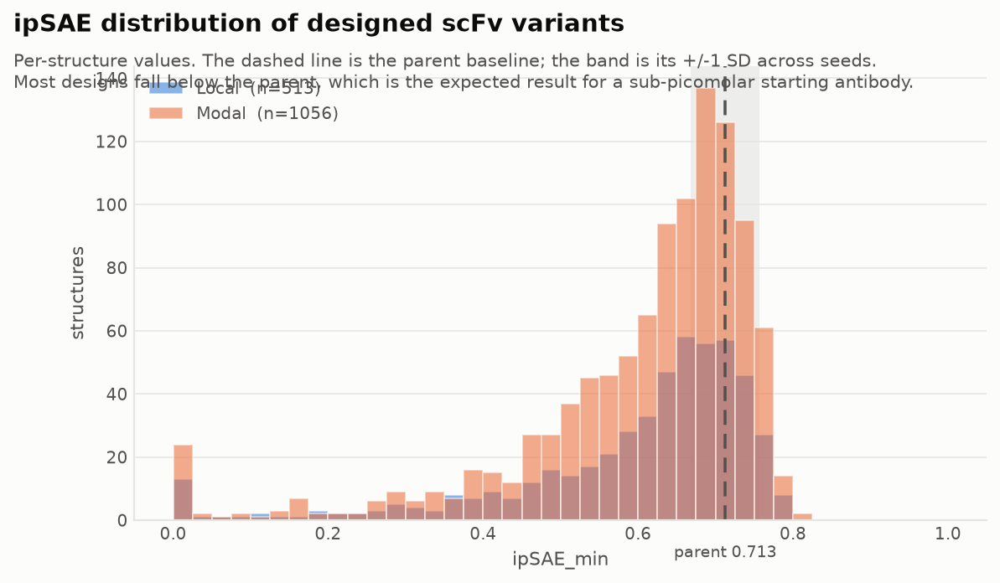
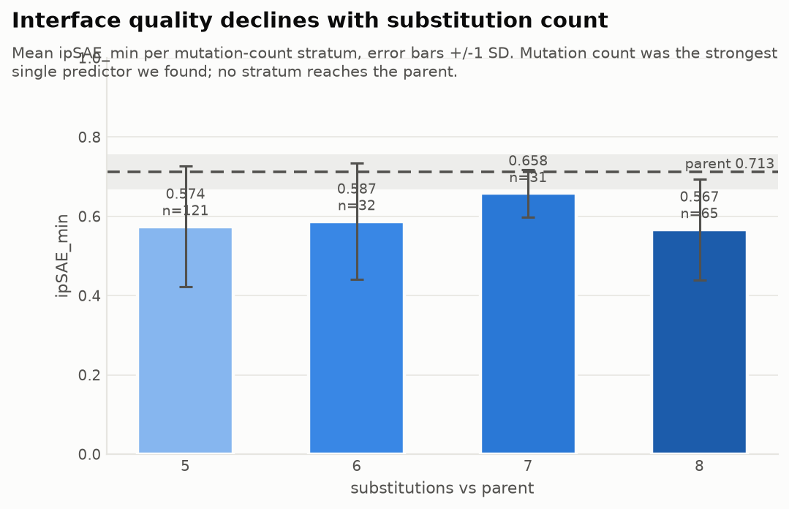
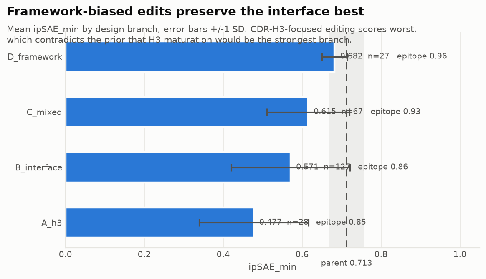
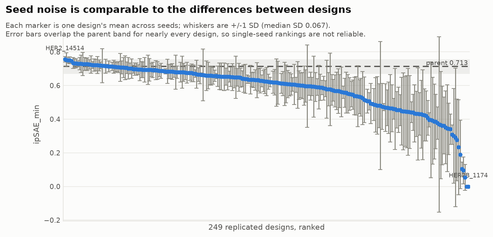
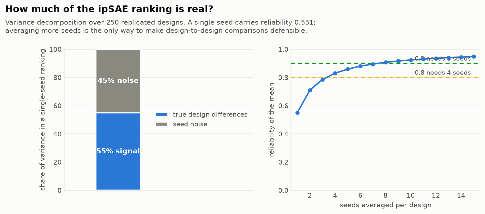
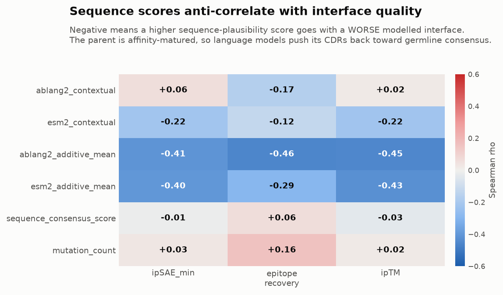
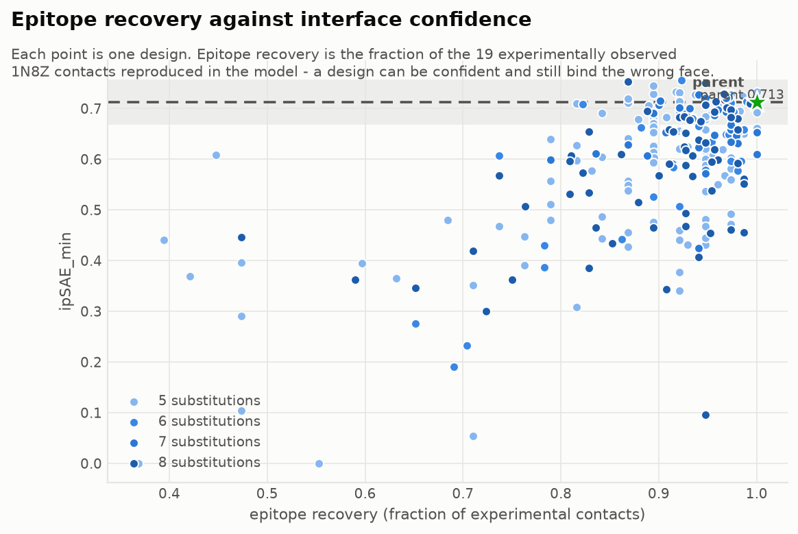
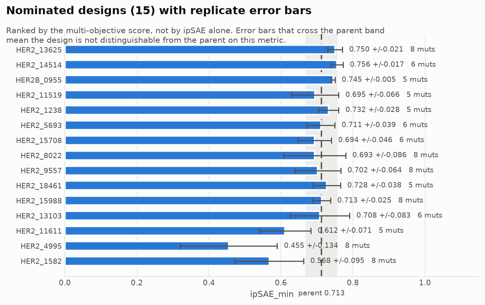
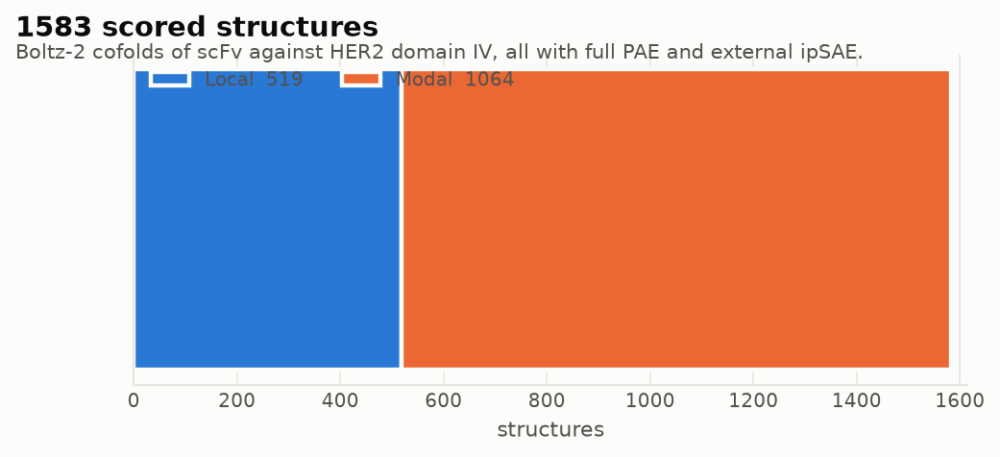

# Modal run report - HER2 scFv optimisation

Generated 2026-10-31T15:08:28+00:00. Regenerated automatically as results arrive.

> **Claim boundary.** Every value here is a computational ranking signal for experimental triage. ipSAE is not a binding affinity, ipTM is not ipSAE, and a higher score is not a demonstrated improvement. No K_D is predicted.

## Summary

| Quantity | Value |
| --- | ---: |
| Structures scored on Modal | 1064 |
| Distinct designs | 149 |
| Parent replicates | 8 |
| Mean seeds per design | 7.09 |

Per-design mean ipSAE: n=149  min=0.0934  median=0.6443  mean=0.6035  max=0.7602

## Throughput and cost

| Phase | Purpose | Structures | Elapsed | Est. cost | State |
| --- | --- | ---: | ---: | ---: | --- |
| A | error bars on all submitted designs (7 seeds) | 1050/1050 | 47.7min | $4.83 | complete |
| B | balanced mutation-count sweep (5 seeds) | - | - | - | not started |
| C | stratified breadth with replicates (5 seeds) | - | - | - | not started |
| D | deep replication of nominees (20 seeds) | 144/240 | 9.6min | $0.66 | running |

Structures completed on Modal so far: **1194**.

Cost is estimated at ~$0.0046 per structure (~15 s on an A10G at ~$1.10/GPU-hour); the authoritative figure is the Modal usage dashboard.

## Measurement reliability

| Quantity | Value |
| --- | ---: |
| Designs with replicates | 250 |
| sd within design (seed noise) | 0.1179 |
| sd between designs (true, est.) | 0.1306 |
| Reliability of a single seed | **0.551** |
| Reliability of the current mean | 0.886 |
| Seeds for reliability 0.8 / 0.9 | 4 / 8 |

Reliability is the share of ranking variance that is real signal rather than seed noise. This governs every comparison below: a single-seed ipSAE table is not an ordering of design quality.

### Designs tested against the parent

Parent 0.7127 +/- 0.0445 over 14 seeds; threshold |t| > 2.

- above parent: **5**
- below parent: 138
- indistinguishable: 106

## Do sequence scores predict structure?

| Predictor | vs ipSAE | vs epitope recovery | vs ipTM |
| --- | ---: | ---: | ---: |
| `ablang2_contextual` | 0.060 | -0.168 | 0.022 |
| `esm2_contextual` | -0.217 | -0.122 | -0.223 |
| `ablang2_additive_mean` | -0.412 | -0.459 | -0.451 |
| `esm2_additive_mean` | -0.402 | -0.295 | -0.425 |
| `sequence_consensus_score` | -0.010 | 0.065 | -0.033 |
| `mutation_count` | 0.033 | 0.158 | 0.023 |

Negative means a higher sequence-plausibility score goes with a **worse** modelled interface. The parent is affinity-matured, so antibody language models push its CDRs back toward germline consensus - away from the residues that contact HER2.

### By substitution count

| Group | n | ipSAE mean | sd | ipTM | epitope recovery |
| --- | ---: | ---: | ---: | ---: | ---: |
| 5 | 121 | 0.5741 | 0.152 | 0.840 | 0.869 |
| 6 | 32 | 0.5869 | 0.146 | 0.845 | 0.902 |
| 7 | 31 | 0.6577 | 0.060 | 0.881 | 0.936 |
| 8 | 65 | 0.5668 | 0.128 | 0.839 | 0.892 |

### By branch

| Group | n | ipSAE mean | sd | ipTM | epitope recovery |
| --- | ---: | ---: | ---: | ---: | ---: |
| A_h3 | 28 | 0.4772 | 0.139 | 0.796 | 0.847 |
| B_interface | 127 | 0.5706 | 0.150 | 0.838 | 0.859 |
| C_mixed | 67 | 0.6152 | 0.105 | 0.862 | 0.928 |
| D_framework | 27 | 0.6823 | 0.033 | 0.892 | 0.965 |

## Figures

**ipSAE distribution of designed variants**

**Interface quality vs substitution count**

**Interface quality by design branch**

**Seed noise against between-design differences**

**How much of the ipSAE ranking is real**

**Sequence scores vs structural outcomes**

**Epitope recovery against interface confidence**

**Nominated designs with replicate error bars**

**Structures scored, by compute source**

